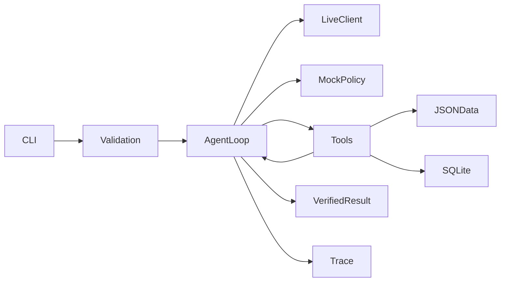

# 技术方案

模块：models 严格输入校验，time_utils 时区和半开区间，policy 用户授权，storage SQLite，tools 工具契约，agent 循环及核验输出，llm_client 真 HTTP 客户端，mock_policy 离线策略，trace 自动日志，main CLI。

模型只选择工具及参数或 finish，不自由生成业务成功状态。工具观察回填 role=tool；下一轮模型实际选择才成为上一条 Trace 的 next_action。Trace 不保存隐藏推理或密钥；finish 的 decision_basis 是模型公开短理由，业务结果仍由应用层生成。

工具统一返回 ok/data/error：get_material、check_rules、query_slots、save_draft。模型没有任意代码执行能力，也没有 confirmation_state 或 request_id 修改工具参数。save_draft 从绑定请求读取授权，再核验规则；任何未批准状态都拒绝。补查由模型主动重读素材，模拟数据没有外部补全源。

硬性变更只认外部 confirmed_alternative_time；候选不是授权。soft 改期需要允许建议且记录原因。待确认建议不存储。所有保存最终复查当前 DB 和已有排期。唯一 SHA-256 key、请求完整内容指纹、BEGIN IMMEDIATE 事务共同防止重复与覆盖；同一事务查询冲突并插入，异常回滚。request_id 已保存后改变内容需新 ID。

已有排期/草稿均用 UTC aware datetime 比较 [start,end)，展示转换到输入 IANA 时区。每素材 60 分钟是明确合成假设。候选扫描最多 48 步，是 demo 的搜索上限，可进一步引入营业日历。

模型返回格式严格校验，未知工具、错参数均拒绝或产生结构化失败。两次模型调用/格式错误即 incomplete；工具异常结构化返回以供模型调整。8 轮/10 工具默认上限，可 CLI 调整。保存故障显式注入，绝不修改真实回执。标准库 HTTP 降低依赖，pytest 做验收，tzdata 支持 Windows。
